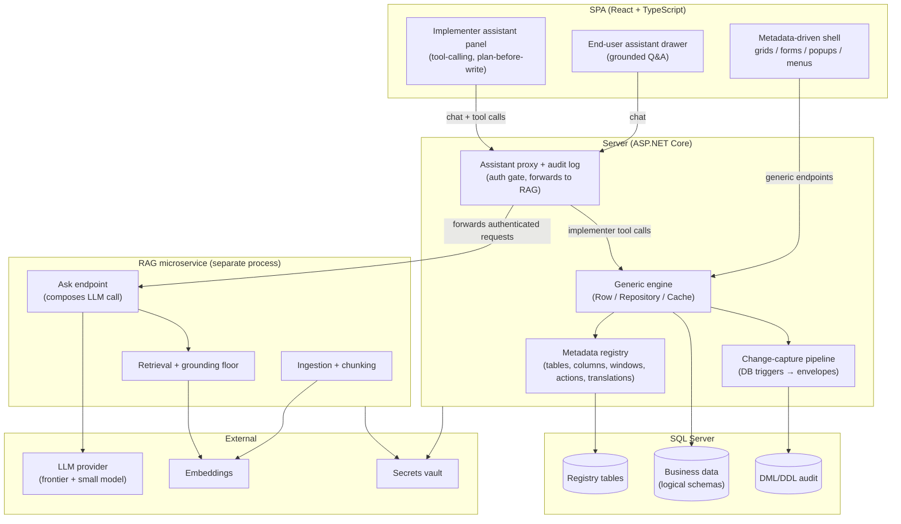
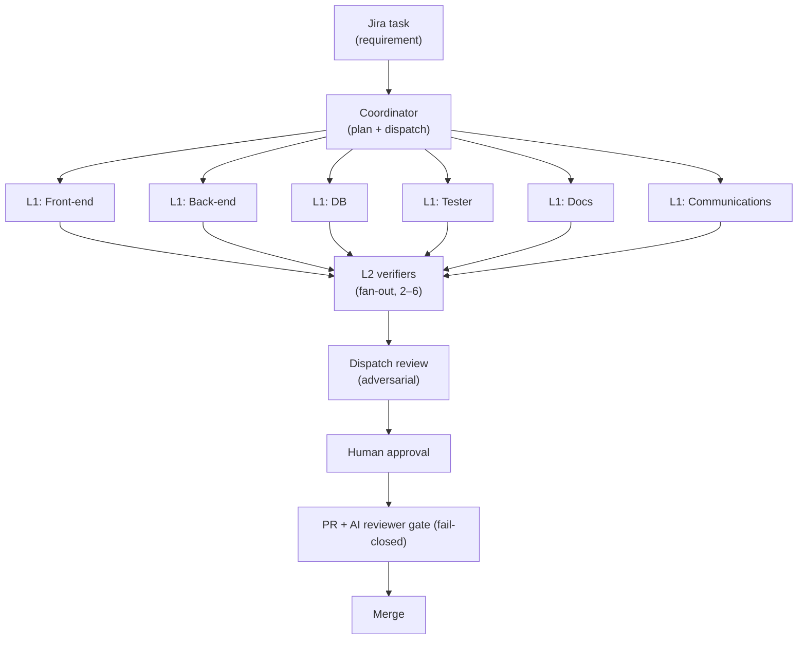
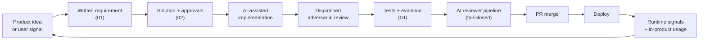

# Agentic Engineering Portfolio

**Taking an enterprise framework from idea to production with an AI-native development model — and shipping AI agents inside the product itself.**

By [**Tiberiu Pfiszter**](https://www.linkedin.com/in/tiberiu-pfiszter/) · BTEC Information Technology

---

> This repository is a sanitized, public technical overview of a real, in-production enterprise framework.
> Proprietary source code, client data, and internal names are intentionally omitted.
> Patterns, architecture, principles, and the development model are faithful to the real project.
> See [About This Repository](#about-this-repository) for the full disclosure.

---

## Table of contents

- [Why this project exists](#why-this-project-exists)
- [What I built](#what-i-built)
- [Two layers of AI — build vs. in-product](#two-layers-of-ai--build-vs-in-product)
- [Architecture at a glance](#architecture-at-a-glance)
- [AI-native development](#ai-native-development)
- [Agentic development architecture](#agentic-development-architecture)
- [In-product AI agents](#in-product-ai-agents)
- [Human oversight](#human-oversight)
- [From idea to production](#from-idea-to-production)
- [Automation](#automation)
- [Product and engineering impact](#product-and-engineering-impact)
- [A concrete case — WiData / WiData Inventory](#a-concrete-case--widata--widata-inventory)
- [Technology](#technology)
- [Lessons learned](#lessons-learned)
- [About this repository](#about-this-repository)

---

## Why this project exists

Enterprise logistics, warehousing, and operations software has a chronic maintainability problem. The same abstract capabilities — tables, forms, grids, dictionaries, roles, migrations, imports, exports, reports — are rebuilt for every customer, in slightly different ways, by slightly different people. Over a few years each deployment becomes a drift of hand-written variations, and shipping a cross-cutting change (new audit rule, new permission model, new report style) means touching every customer branch individually.

The Platform documented here replaces that model. The application behavior is driven by metadata: a small set of registry tables describes what tables and columns exist, how grids and forms render, what actions can be invoked, how FKs resolve, how translations work. A single generic engine reads that metadata at runtime and renders both the SPA and the server behavior from it. Adding a new business entity is a configuration task, not a code task; shipping a cross-cutting change means changing the engine once.

That design opened a second opportunity. If the application is described by its own metadata, then an AI agent can read that metadata and operate the application the way a human implementer would — read tables, propose a new form, create a dictionary, run a safe query. On top of that, if development itself is driven by principles that can be checked mechanically, then a multi-agent system can take an engineering task from Jira all the way to a merged PR, with human engineering judgment preserved at the right checkpoints.

Both of those directions are now live. This repository explains how.

## What I built

I personally:

- **Architected** the metadata-driven engine (registry tables + generic Row/Repository/Cache runtime + runtime schema and SQL assembly). New business tables, forms, grids, FKs, lookups, translations, and actions are configuration, not code.
- **Designed** the two-tier AI model used throughout the project: a build-time multi-agent development workflow and two runtime assistants embedded in the product.
- **Implemented** the backend (ASP.NET Core, SQL Server) and the SPA (React + TypeScript), plus the migration-capture pipeline that turns real app edits into deployable envelopes without hand-written SQL.
- **Automated** the development lifecycle: traceability files per task, pre-commit and pre-push gates, an AI reviewer pipeline that enforces architectural principles on every PR, and a work-mode integration that keeps the Jira state consistent with reality.
- **Introduced** the DevelopmentTracking discipline — every non-trivial change leaves a mechanically-verifiable trail (requirement → solution with approvals → tests), gated locally by hooks and finally by a fail-closed CI reviewer.
- **Led** the engineering team's adoption of this model, continuing to write and ship code myself. Leadership is additional, not substitute.

My angle is a hands-on software engineer and architect who designs the system, builds it, and keeps writing code — AI-native, product-focused, accountable for the result.

## Two layers of AI — build vs. in-product

This is one of the key ideas the repository is meant to communicate.

There are two completely separate AI layers in play, and treating them as "the same thing" is a category error that leads to the wrong permissions model, the wrong guardrails, and the wrong trust assumptions.

| Dimension | **Build-time agents** (build the product) | **In-product agents** (shipped to users) |
|---|---|---|
| **Purpose** | ship engineering work: design, implement, review, test, document | assist end users and implementation specialists operating the product |
| **Context** | the repo + principles + task spec + Jira + CI | the runtime session: current user, roles, in-scope data, product docs |
| **Permissions** | the engineer's git credentials and local dev environment | the end user's role matrix inside the application |
| **Tooling** | file I/O, shell, git, cloud CLI, dispatch to other agents | a curated typed catalog of operations against the metadata and data layer |
| **Validation** | adversarial code review, principle-conformance checks, traceability files, CI reviewer | per-tool approve/cancel UX, SQL guard, grounded retrieval, grounding floor |
| **Primary risk** | code quality drift, principle erosion, test-mocking the wrong thing | arbitrary data write, information leak, hallucinated plans applied to real tables |
| **Human oversight** | PR review, dispatched verifier reviews, 04-Tests evidence attached to the ticket | plan-before-write UX; writes always surface for human approve/cancel |

Dedicated documents:

- [docs/agentic-build-workflow.md](docs/agentic-build-workflow.md) — the build-time multi-agent model.
- [docs/in-product-ai-agents.md](docs/in-product-ai-agents.md) — the two assistants shipped inside the product.

## Architecture at a glance

Full write-up in [docs/architecture.md](docs/architecture.md).

## AI-native development

The guiding idea is simple and non-negotiable:

> **AI should multiply engineering output without transferring engineering accountability to the AI.**

A conventional "AI writes code" setup fails on real projects because an unconstrained generator can produce plausible but architecturally wrong code at a rate humans cannot review. The move that makes it work is to put AI *inside a controlled engineering system* where principles, context boundaries, specialization, verification, and human ownership are explicit and mechanically enforced.

Concretely:

- Principles are a canonical, versioned document — the authoritative one, not memory snippets. Every agent reads it at the start of a session.
- Context is deliberately scoped. A reviewer sees a specific slice of the repo and nothing else; a worker sees its branch and nothing else.
- Specialization is real. There is a dispatcher, L1 verifiers per discipline (docs, front-end, back-end, tester, DB, communications), and L2 verifiers that fan out for independent adversarial reviews.
- Verification is adversarial, not confirmatory. Reviewers are asked to argue the code is wrong, not that it is right.
- Human ownership is designed in. There are explicit gates where no agent proceeds without a human `go`, and traceability files per task make the human decision auditable.

Full write-up in [docs/ai-native-development.md](docs/ai-native-development.md).

## Agentic development architecture

The build-time model has one coordinator, six L1 verifiers, and a pool of L2 verifiers that fan out for review.

Full write-up in [docs/agentic-build-workflow.md](docs/agentic-build-workflow.md).

## In-product AI agents

Two assistants are shipped inside the product. They look like one feature from the outside but are completely different systems inside.

**End-user assistant (grounded Q&A).** A right-side drawer in every screen. Answers questions about the product in the user's language, grounded on an indexed knowledge base. It has no tools, no writes, no actions. If the retrieved context does not clearly answer the question, it refuses. Backed by a small, fast model to keep latency and cost predictable.

**Implementer assistant (agentic tool caller).** A dedicated admin panel for implementation specialists. It has a curated tool catalog that goes through the same typed persistence layer as the UI, so permissions, audit, hooks, and translations fire exactly as if a human admin were clicking. Every write surfaces a plan card first; nothing is applied without a human approve. Backed by a frontier model.

Both agents log every turn into an append-only audit table — user, question, response, tool calls, token counts, duration. Attachments are never stored verbatim; only file metadata.

Full write-up in [docs/in-product-ai-agents.md](docs/in-product-ai-agents.md).

## Human oversight

Where the model and the agents are usable, and where they must be overridden by a human, with real examples:

- **Architecture.** Agents can refactor inside a boundary but cannot change a boundary. A new cross-cutting mechanism (new cache layer, new sync lane, new permission axis) is a human decision.
- **Security and permissions.** Any change that touches authorization is reviewed by a human and gated by a dedicated verifier, regardless of agent confidence.
- **Business rules.** Behavior that encodes a business policy is written by a human against a written requirement; agents assist, they do not decide.
- **Database changes.** Schema changes are captured, not hand-written. A human owns the approval of the resulting envelope before it reaches shared environments.
- **Backwards compatibility.** Agents frequently propose "clean" changes that silently break older data shapes. Humans guard the compatibility contract.
- **Hallucinated plans.** Plausible-sounding plans against the metadata are the most dangerous output. The plan-before-write UX exists because of this failure mode.
- **Tests that validate the wrong assumption.** A green test suite proves nothing if the assertions are agent-written against the agent's model of the world. Humans review the assertions, not just the pass/fail.

## From idea to production

Full write-up in [docs/product-development.md](docs/product-development.md).

## Automation

What has been automated end-to-end:

- **Traceability.** Each task writes a requirement file, a solution-with-approvals file, and a test-evidence file; hooks block commits and pushes that skip them.
- **Code review.** A CI pipeline runs an AI reviewer against every PR for scope conformance and principle compliance. Fail-closed; cannot be bypassed locally.
- **Migrations.** The database never receives hand-written SQL migrations. The engine captures real admin edits and emits deployable envelopes.
- **Live mirroring.** System-side admin edits replicate to registered test deployments in the same transaction, so a change made once propagates everywhere immediately.
- **Work-mode.** Jira state (In Progress / Done / Actual start / Actual end / worklog) is advanced by scripts tied to real events — selecting a task, merging a PR, closing a day — with human confirmation of the time value.
- **Secrets.** No secret is ever committed. A one-shot push to Key Vault seeds the deployments.

## Product and engineering impact

Supported by the real project, stated conservatively:

- **Faster delivery of new business entities.** Adding a new entity (table, grid, form, FKs, translations, menu entry) is predominantly a configuration task, not an engineering task; the engine delivers it without per-entity controller or UI code.
- **Lower variance across customer deployments.** Logical schemas and overlay routing eliminate per-customer forks of the same table.
- **Consistent principles across hundreds of changes.** A codified principles document, enforced mechanically, keeps review quality predictable regardless of session.
- **Higher developer leverage.** A pool of specialized agents handles the mechanical portion of a change (grep, read, implement, cross-check, draft tests), leaving the engineer in a planner-reviewer role for the parts that matter.
- **Lower regression risk from LLM output.** Adversarial review, principle gates, and traceability files substantially reduce the "plausible but wrong" class of defect that otherwise dominates AI-assisted codebases. Not eliminated — the gates catch the class the discipline is designed to catch; novel failure modes still rely on human judgement.

No fabricated metric is included here. The repository is a technical overview, not a marketing deck.

## A concrete case — WiData / WiData Inventory

The framework described here has a lineage. Between **2014 and 2026** I built an earlier generation of the same metadata-driven engine, used as the foundation for the **WiData** platform and its **WiData Inventory** application — a production warehouse-management system **in production since 2015**, running at **tens of customers**, with a single deployment reaching **more than 10,000 users**.

A public presentation of WiData Inventory is available on YouTube: [Prezentare WiData Inventory](https://www.youtube.com/watch?v=8Oi9CupwpsY).

The current framework is a redesigned, modernized successor to that work. The ideas carried forward — metadata-driven engine, generic runtime, logical schemas, migration-capture pipeline, live replication in the capture trigger — are the ones that survived a decade of production exposure. The things that are new — the AI-native development model, the two in-product assistants, the modern SPA stack, cloud-native deployment — are what makes this generation different from the first.

The point of citing this case: the architecture argued in this repository is not an idea. It is a proven pattern that has been in production for over a decade, at a real scale, by the same architect, re-expressed on a current stack with the lessons from the first decade built in.

Full write-up: [docs/case-study-widata.md](docs/case-study-widata.md).

## Technology

**Production stack**

- ASP.NET Core / .NET
- React + TypeScript
- SQL Server
- Azure (App Service / VM, Key Vault, DevOps)

**AI stack**

- Anthropic Claude (frontier model for tool-calling agent, small model for grounded RAG)
- Voyage embeddings for retrieval
- Prompt caching for cost and latency

**Development tooling**

- Claude Code (coordinator + L1 verifiers + L2 fan-out)
- Jira (requirements and work-mode)
- Git hooks (pre-commit, pre-push) and a CI AI-reviewer pipeline

**Experimental**

- Dynamic workflow orchestration patterns across multiple agents

## Lessons learned

A few non-generic findings from running this model across hundreds of real sessions. Full list in [docs/lessons-learned.md](docs/lessons-learned.md).

- **Specialization beats scale.** A pool of narrow verifiers reviewing adversarially catches more real defects than a single large generalist agent reviewing confirmatorily.
- **Context size has a cliff.** Beyond a point, more context makes agents worse, not better: they stop reading, start pattern-matching, and produce plausible-but-wrong code. Deliberate context scoping is a correctness mechanism, not a cost mechanism.
- **The dangerous output is the plausible one.** An obviously wrong plan is easy to reject. A plan that looks right against a flawed model of the system is the one that ships bugs. Plan-before-write and adversarial review exist to catch this.
- **Mocks in AI-written tests are a trap.** It is easy to generate tests that pass because they assert the agent's own assumptions. Keep integration tests close to the real DB and real wire paths.
- **Human ownership stays, even when agents do more.** The engineer's job shifts from "write code" to "define the shape, review the delta, own the result". Not less work; different work.

## About this repository

This repository is a sanitized, public technical overview of a real production software engineering project.

- **Not a drop of production source code is included.** Everything here is architectural narrative, principle, and pattern.
- **Diagrams and examples are simplified or synthetic.** Where an example appears, it is labeled as such.
- **The current platform's internal name, owning company, and customers are omitted.** The one product referenced by name is **WiData / WiData Inventory**, the predecessor platform I built between 2014 and 2026, which has a public presence (see the [case study](docs/case-study-widata.md)) and is cited here with the operator's standing public positioning.
- **Only my own name and my current employer (BTEC Information Technology) appear** in attributions.
- **Jira ticket IDs, internal paths, prompt bodies, and schema identifiers are omitted.**
- **No secrets, credentials, hostnames, or connection strings are published.**
- **This repository is initialized as a new git history** — the current project's git history is not reused here.

If you are a senior engineer, technical founder, or hiring manager reviewing this: the goal is to show you *how I think and build*, not to publish the thing I built. Please read the docs and let me know what parts you want to go deeper on.

---

## License

Content is licensed under [CC-BY-4.0](LICENSE). Patterns and principles are free to adopt with attribution.
