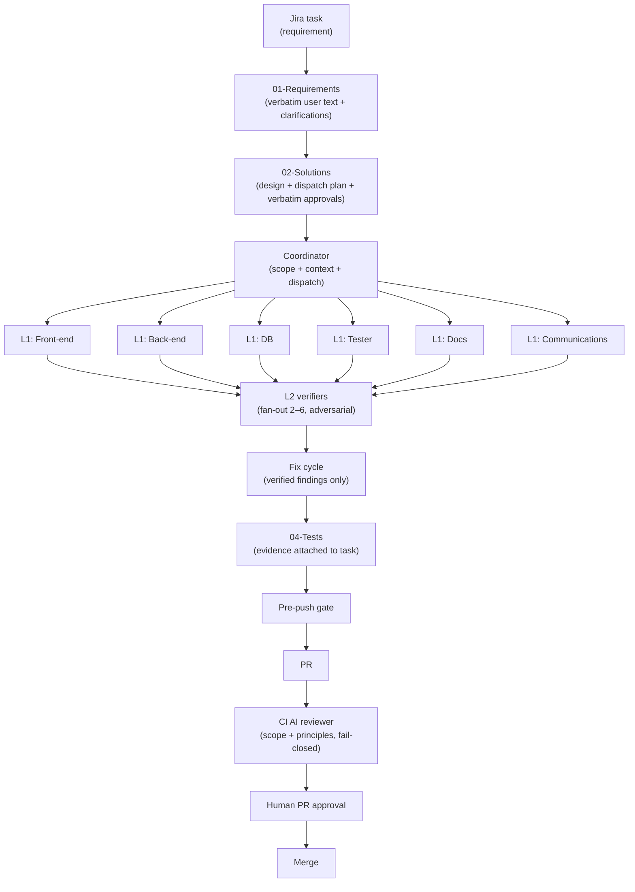

# Agentic build workflow

> How a task actually flows from a Jira requirement to a merged PR, through a coordinated team of specialized agents and mechanical gates.
>
> Companion document: [ai-native-development.md](ai-native-development.md) explains the philosophy; this document explains the mechanics.

## 1. Overview

Every arrow in that diagram is enforced by something — either a human checkpoint or a mechanical gate.

## 2. Roles

### Coordinator

A single agent per session. Reads the principles document, reads the task, writes the plan, dispatches the work. Does not write production code itself except where explicitly scoped by a tiny task. Its job is to decompose, scope, and dispatch; and to review the integrated result against the plan.

### L1 verifiers (one per discipline)

- **Docs.** Owns technical documentation — architecture notes, concepts, runbooks. Blocks changes to functional surfaces that fail to update docs in both supported languages.
- **Front-end.** Owns the SPA — components, state, typing, accessibility, i18n coverage, visual consistency.
- **Back-end.** Owns the server — controllers, services, transactions, error handling, principle conformance (raw SQL categories, no silent catches, no hardcoded identifiers).
- **Tester.** Owns test design — scope, assertions, which tests are integration vs. unit, which assumptions each test actually validates.
- **DB.** Owns schema, metadata, migrations, triggers, capture pipeline, replication. Also owns the review of any raw SQL that leaks into business code.
- **Communications.** Owns the PR body, the release note, the ticket update, and anything the human will read as a summary.

Each L1 has:

- A tailored prompt that encodes its discipline's principles.
- A tool allow-list — e.g. the Docs L1 cannot run shell commands; the DB L1 cannot touch SPA files.
- A fixed output format — short, structured, with file-and-line references.

### L2 verifiers (fan-out pool)

Independent reviewers used by the L1 verifiers for adversarial verification. An L1 produces a finding; one or more L2s try to refute or confirm it. The number that fan out depends on the stakes of the change: 2 for a localized refactor, 6 for anything touching permissions, migrations, or the capture pipeline.

L2s see only the slice of the change the L1 points them at. Their output is a concrete scenario: either "this fails when X" or "I cannot construct a failure scenario".

## 3. Context boundaries

Each role sees a different slice:

| Role | Can see | Cannot see |
|---|---|---|
| Coordinator | principles, task, high-level repo structure | the full codebase (reads on demand only) |
| L1 verifier | the files relevant to its discipline for this change | files outside its discipline |
| L2 verifier | the exact slice the L1 asked about | anything else |
| Worker (implementation agent) | the files relevant to the task + the design file | files outside its scope |

The point is not to prevent spying. The point is to prevent agents from writing code that reads correctly against a shape they absorbed from unrelated files. Scoped context is a correctness mechanism.

## 4. The traceability trio

Every non-trivial change writes three files, in order, before the work advances. All three are versioned in the repo.

### 01-Requirements

The user's text verbatim, plus any clarifications that were agreed. "Verbatim" is literal — the file contains what the user actually wrote in Jira or chat, quoted. The agent's paraphrase does not count.

Blocked by: a pre-commit hook. No touched-code commit for a given task can land without this file.

### 02-Solutions

The design: approach, affected files, the exact dispatch plan (which L1 goes where, which L2 fans out, with how many parallel reviews), the risk analysis, the open questions. Plus a **Verbatim approvals** section: for every decision that changes functionality, the exact question the coordinator asked and the exact answer the user gave, copied as-is. That is the proof the user actually approved the plan.

Blocked by: a pre-commit hook. The CI AI reviewer re-reads this file and refuses the PR if a scope decision in the diff lacks a matching verbatim approval.

### 04-Tests

The evidence that the thing works: what was tested, what the result was, where the artifacts are. For UI-touching changes, screenshots are attached to the Jira ticket (as a .docx bundle) before the PR is reviewed; for backend changes, logs and query results are referenced.

Blocked by: a pre-push hook. No push of touched code lands without this file.

## 5. The dispatch pattern

The coordinator does not write business code itself. It dispatches.

A typical dispatch has three phases:

### Phase 1 — Review

For each discipline the change touches, an L1 verifier reads the current state and the design file, and produces findings against the proposed change.

### Phase 2 — Verify

Every finding goes to a fan-out of L2 verifiers. Each L2 tries to refute the finding with a specific scenario. Only findings that survive adversarial verification continue; the rest are dropped with a note.

### Phase 3 — Fix

Verified findings are addressed with a single-pass fix, then one re-review. Not an open loop. Review cycles are deliberately capped — "one fix + one delta re-review" is the pattern.

This is the pipeline the CI reviewer independently runs on the PR as a safety belt.

## 6. Mechanical gates

Four gates, from local to CI:

1. **Pre-commit (hooks).** Blocks commits that contain hand-written SQL migrations, raw SQL in business code without a justification comment, string literals in error messages that should be translated, scratch files that should not be committed. Also blocks commits for a task that lacks 01-Requirements + 02-Solutions.
2. **Pre-push (hooks).** Blocks a push of touched code for a task that lacks 04-Tests.
3. **CI AI reviewer.** Runs on every PR, independent of local hooks. Verifies existence of the traceability trio, scope conformance against the written requirements, and principle compliance against the diff. **Fail-closed** — a bypassed local hook cannot sneak past it.
4. **Human PR review.** A human engineer reads the diff and the AI reviewer report, and approves or requests changes.

Each gate exists because the previous one is bypassable at some level. The CI reviewer specifically exists because any local hook can be `--no-verify`-d.

## 7. The "verbatim approvals" rule

The single most important discipline on the human side.

Every decision in a 02-Solutions file that changes functionality must be backed by the exact question-and-answer exchange with the user. Not a paraphrase. Not "the user agreed". The actual words.

Why: an agent summarizing an approval often turns a scoped "yes, for this one call site" into an unscoped "yes, go". The verbatim rule makes that drift impossible to hide. On review, the reviewer reads the user's actual words and judges whether the diff matches the user's actual approval.

## 8. Communication artifacts

A merged PR produces three artifacts for other humans:

- The PR body, written by the Communications L1 verifier from the traceability files. Short, structured, no AI buzzwords.
- A test-evidence attachment on the Jira ticket (`.docx` with screenshots or structured logs).
- A compressed transcript of the agent sessions, archived to the ticket after the PR is accepted. This is the audit trail for *how* the change happened, not just that it did.

Communication artifacts are not a nice-to-have. They are what makes the model reviewable by a colleague six months later.

## 9. Failure handling

What happens when a gate fails:

- **Pre-commit / pre-push failure.** The engineer fixes the underlying issue. Hooks are not bypassed with `--no-verify` casually — the two escape hatches that exist are *logged* with a reason, which the CI reviewer can see.
- **L1 or L2 verifier finds a real issue.** The coordinator schedules a scoped fix pass, then one re-review. Not an open-ended loop.
- **CI AI reviewer rejects the PR.** The reviewer's report is the specification for what to change. The coordinator does the fix pass with the same discipline as any other finding.
- **Human reviewer rejects the PR.** The human's rationale enters the 02-Solutions "Decisions & approvals" section verbatim. The next iteration starts there.

Failures are not errors to be routed around. They are the system doing its job.

## 10. Work-mode integration

The engineering workflow is tied to the Jira state through scripts:

- **Starting a task** advances it to In Progress and records the actual start time.
- **Merging a PR** computes the elapsed time, asks the human to confirm the value, logs the worklog, records the actual end time, and advances the task to Done.
- **Closing a day** aggregates and submits the day's worklogs after human confirmation.
- **Pausing or cancelling** advances the task back to the right state without silent data writes.

Nothing writes to Jira without the human confirming the time value. The automation is a convenience, not a bypass.

## 11. Why this model works

- **Principles are canonical** — one source of truth, read by every agent at every session, enforced mechanically.
- **Context is scoped** — correctness mechanism, not a cost mechanism.
- **Review is adversarial** — the agent that wrote the code never reviews it, and reviewers try to refute, not confirm.
- **Traceability is mandatory** — every change leaves an auditable trail, and the gates refuse to proceed without it.
- **Human ownership is designed in** — the engineer approves the plan, approves the diff, approves the tests, and owns the merged result.

The system shifts the engineer's role from typist to planner-reviewer-owner. It does not shift accountability off the human.
