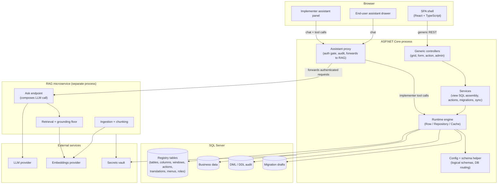
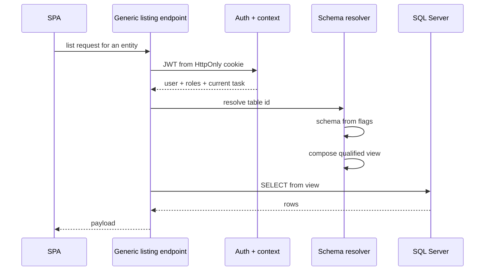

# Architecture

> Sanitized architectural overview of the Platform. Internal product names, schema names, controller names, file paths, and ticket identifiers are omitted. The structural ideas are faithful to the real system.

## 1. Design goals

The Platform is an enterprise framework for operations software (warehouse management, transport management, custom back-office apps). Three goals shape every decision below:

1. **New business entities should be configuration, not code.** A new table with its grid, form, FKs, and translations must be addable without touching a controller, a repository, or a React component.
2. **The same engine must serve many deployments at once.** A reference environment ships metadata and masterdata to many customer instances. Changes to shared masterdata must propagate automatically; customer-local data must stay isolated.
3. **Development itself must be enforceable.** Principles exist as a document; the system must make it mechanically expensive to violate them.

## 2. Layered view

## 3. Core idea: metadata is the application

A small set of registry tables describes everything the application does:

- A table of tables — logical name, physical name, flags (is-masterdata, has-audit, has-translations, is-cached, is-active-managed), owning application.
- A table of columns — one row per column, carrying type, nullability, FK target, whether it is a primary key, whether it is a descriptor (the human label of a row), whether it is translated, whether it is a virtual expression, whether it is a secret.
- Tables for windows, panels, tabs, filter fields — the shape of grids and forms.
- A table of actions — invokable operations, with their parameters, pointed at concrete code via metadata.
- A table of translations — a flat key-value store with a row per language.
- Trees of menus, roles, lists, bit-lists.

A generic runtime reads this at startup and services every request from it. There is no per-table controller, no per-table repository, no per-table React component. Adding a new business entity is adding registry rows.

### Why that matters

The alternative — one controller/repository/UI per table — is what makes enterprise software decay: hundreds of near-identical files that drift. Cross-cutting changes (new audit rule, new permission axis, new report style) must touch each of them. The metadata-driven model collapses that fan-out: the change happens once, in the engine; every entity gets it automatically.

## 4. The runtime engine

Three cooperating layers:

- **Row.** An abstract base for every entity. Reads columns from the metadata cache, holds the current and prior values, tracks dirty fields, builds parameterized `INSERT`/`UPDATE`/`DELETE` dynamically from the column list, runs a hook pipeline for before/after save, auto-stamps the audit columns, auto-emits translation rows for translated columns, honours the sync-mode row-eligibility rule.
- **Repository.** Generic CRUD per row type. Reads go through a view resolver that assembles the SQL at request time from the column metadata (physical columns, virtual expressions, descriptor joins for FKs, translation joins where the descriptor is translated). Writes go through the Row so hooks and audit fire. Access control is enforced per table on both read and write.
- **Cache.** Per-table row-data cache for tables flagged as cached. An atomic-swap rebuild under a replay buffer keeps the cache consistent during reload. Metadata itself is cached separately with a different invalidation lifetime.

Nothing about any specific table is hard-coded. The engine is the application.

## 5. Logical schemas and multi-DB routing

Schemas are logical, not physical, resolved at runtime from table flags:

- Masterdata tables resolve to the admin schema.
- Non-masterdata with a system-data flag resolve to the working schema.
- Everything else resolves to the customer schema.

Schema names come from config, so a legacy database that already carries one of those schema names can be onboarded without renaming anything.

On the reference environment, the framework's metadata lives in one database, business objects for each application in sibling databases. A qualified name is built at runtime; it is a two-part name on same-DB access and three-part only when the target DB differs from the connection catalog. On a customer deploy the model collapses to a single DB — qualification stays two-part regardless of what the baseline carried.

The implication for diagnostics: a qualified name you see in a log is not stored, it was composed per call. The same table yields different strings on different connections. This has prevented a lot of false "the data is in the wrong place" diagnoses.

## 6. Change-capture pipeline

Enterprise frameworks traditionally ship schema and masterdata changes as hand-written SQL migrations. That approach fails at scale: the files drift, their order breaks, their contents get edited to "fix things up", and the deployed state eventually diverges from what any file says.

The Platform never writes a SQL migration by hand. Instead, in chronological order:

1. **Capture.** Every write on a monitored table fires a generated DML capture trigger. Every DDL event on a monitored database fires a single DDL capture trigger. Both validate a session context (an authenticated user and a selected task) and refuse unauthenticated writes.
2. **Audit.** Each captured event appends one row to the audit tables, tagged with user, task, and a row snapshot (for DML).
3. **Replicate (in-trigger, same transaction).** On the reference environment, the same trigger section replicates the write to registered test deployments **inside the same transaction**, before commit, so a change made once propagates everywhere immediately. (This is only possible because the trigger is the source of truth — the capture pipeline and the live-mirror pipeline cannot drift.)
4. **Drain (end of request).** After the request's transaction commits, successful events are grouped by task and merged into a per-task migration envelope — a JSON document holding both the DML operations and the DDL statements. The audit rows are flagged processed; they stay in the table for later rebuild.
5. **Submit (user-triggered, later).** When the engineer submits the envelope, it is finalized (orphans removed, audit-user columns normalized), zipped into a committed location, and shipped. Customer deployments apply it in version order, skipping anything already applied.

Hand-written SQL files are blocked at commit time. The envelope *is* the migration.

## 7. Request shape

A typical read request:

A typical write request opens a transaction, writes via the Row, lets hooks fire, lets the capture trigger populate the audit **and replicate the write to registered test deployments in the same transaction**, commits, then drains the audit into the migration envelope — all before the response leaves the server. Replication is in-trigger (before commit), not post-commit; this is what the capture pipeline (section 6) guarantees.

## 8. Integration points

- **LLM provider.** Two assistants call out: an end-user grounded assistant (small, fast model) and an implementer tool-calling agent (frontier model). Covered in [in-product-ai-agents.md](in-product-ai-agents.md).
- **Embeddings provider.** The product doc knowledge base is ingested, chunked, and embedded for retrieval; a boot-time hosted service keeps it current.
- **Secrets vault.** Secrets never land in config files or git. Local dev reads an encrypted bundle; non-dev reads from the vault via managed identity.
- **Identity providers.** External OAuth (Microsoft, Google) and local accounts; access tokens travel in an HttpOnly cookie rather than the `Authorization` header, which the JWT bearer layer is configured to honour.

## 9. Configuration

- One primary config file per deployment, loaded once at process start, cached for the process lifetime.
- Per-instance overrides via env variables that redirect specific config keys to a per-instance vault secret — this is how two sites on one VM read different databases without any code change.
- A client-routing guard at startup refuses to boot a customer deploy that has neither an inline DB connection nor a per-instance override — a safety belt against a client environment accidentally writing to the reference DB.

## 10. Extensibility

Three things any team member can do without touching the engine:

- **Add a business entity.** Insert registry rows for the table, columns, window, menu, roles, translations.
- **Add an action.** Insert a row in the actions registry pointing at a C# method. The engine resolves it by reflection and invokes it with parameters sourced from the registry.
- **Add a dictionary.** Insert a list and its values. The engine renders dropdowns and translates values automatically.

The engineering judgement that stays with the team: when a change pushes against the engine's assumptions, the engine changes; not a special-case controller.

## 11. Deployment concepts

- **Reference deployment** — authoring environment, generates masterdata and migration envelopes; multi-DB.
- **Customer deployment** — applies envelopes, single-DB, cannot generate.
- **Legacy-overlay deployment** — the framework overlaid onto a customer's pre-existing populated DB; inherits the customer-deployment guards, with a narrow slice of boot deviations gated separately.

The guard rails ensure the deploy shape cannot be contradicted at runtime. The reference instance's capture triggers are not shipped to clients; the clients' guards against writing system rows are not disabled in reference mode.

## 12. What is deliberately not here

- Any physical table or column names.
- Any specific controller or endpoint route.
- Any specific identity provider configuration beyond "we support external OAuth".
- Any customer, deployment, or domain names.
- Any numerical constants that would reveal the real schema layout.

Patterns suffice to communicate the design. Specifics would reveal the IP without adding understanding.
