# From idea to production

> How product work actually moves through this system. Not a Scrum ceremony document — a description of the real flow, with the places where product thinking and engineering thinking meet.

## 1. The loop

```mermaid
flowchart LR
    Signal["Signal<br/>(user, support, operations, metric)"] --> Shape["Shape the problem<br/>(what is actually broken?)"]
    Shape --> Req["Written requirement<br/>(01)"]
    Req --> Design["Design + approvals<br/>(02)"]
    Design --> Impl["AI-assisted implementation"]
    Impl --> Review["Dispatched adversarial review"]
    Review --> Tests["Tests + evidence (04)"]
    Tests --> CI["AI reviewer gate (fail-closed)"]
    CI --> Human["Human PR review"]
    Human --> Merge["Merge"]
    Merge --> Deploy["Deploy"]
    Deploy --> Signal
```

Every step is cheap to describe and expensive to skip. The whole point of the model is to make the skipping expensive.

## 2. Signal

Product work does not start with a feature idea. It starts with a signal:

- a user asked for something
- a support ticket revealed a recurring friction
- an operational metric moved
- a cross-cutting pattern surfaced in multiple places at once

The signal is almost never already a requirement. It is raw material.

## 3. Shape the problem

Before any requirement is written, the problem is shaped: what is actually broken, who is actually asking, what does "fixed" look like, what is the cheapest intervention that moves the needle. This step is human — not an agent task.

The output is a short paragraph. If the paragraph is not clear, the next step does not happen yet.

## 4. Written requirement (01)

The user's text goes in verbatim. Then the clarifications are added. Then the agreed scope is stated as declarative sentences, not as implementation hints.

The traceability trio (01 Requirements, 02 Solutions, 04 Tests) is not red tape — it is the contract between the agent and the engineer, between the engineer and the reviewer, between the whole team and the person reading the ticket six months later.

## 5. Design and approvals (02)

The design file states:

- the approach
- the affected files and surfaces
- the dispatch plan — which L1 verifier reviews what, how many L2s fan out, where
- the risks: what might break, what might silently drift, what might not meet a principle
- the open questions and their resolution

Plus a "Verbatim approvals" section: for every decision that changes functionality, the exact question-and-answer with the user, copied as-is.

This is where product thinking and engineering thinking meet. The question "should the drawer close on outside-click?" is a product question with engineering consequences. The decision is made by a human, in writing, and the answer is referenced in the design.

## 6. AI-assisted implementation

The coordinator dispatches. Workers write code against the design file. Nothing is written off-plan.

A worker that would need to deviate from the plan does not deviate — it stops and reports back to the coordinator, who updates the plan with the user's input and reissues the dispatch. The alternative — agents writing "pragmatic improvisation" into the diff — is the dominant source of silent scope creep in AI-assisted codebases.

## 7. Dispatched adversarial review

Every discipline the change touches gets an L1 verifier. Every finding goes through an L2 fan-out that tries to refute it. Only findings that survive adversarial verification make it to the fix cycle.

Review is not a confirmation. It is an attempt to break the change.

## 8. Tests and evidence (04)

For UI-touching changes, the evidence is screenshots on the ticket. For backend changes, logs and query results. For data-flow changes, traced end-to-end runs. The evidence file points at the artifacts; the artifacts are attached to the Jira ticket.

A pre-push hook refuses the push without this file. The CI reviewer rechecks that the evidence covers the touched surfaces.

## 9. CI reviewer gate

An AI reviewer on CI reads the diff, the 01, the 02, and the 04. It verifies:

- the trio exists
- the diff is in scope of what 01 and 02 described
- principle compliance across the diff
- that any `--no-verify` on a local hook has a recorded reason the reviewer can see

Fail-closed. A locally-bypassed hook does not sneak past.

## 10. Human PR review

A human engineer reads the PR body, the diff, the reviewer report, and the 04 evidence. The decision to merge is theirs.

The AI reviewer's job is not to replace the human; it is to make the human reviewer's job cheaper by catching the mechanical defects before the human sees them. The human attends to intent, consistency with the rest of the system, and the parts that depend on judgment.

## 11. Merge, deploy, feedback

After merge the change is deployed. The in-product audit log and runtime metrics show whether users are actually using the thing. If a user signal was the trigger, the loop closes with "did the signal change".

Features that don't change the signal are removed in the next cycle. Features that change it stay and often get a follow-up.

## 12. Where product and engineering meet

Specific places where the two sides have to agree, and the convention we settled on:

| Decision | Where | Who owns |
|---|---|---|
| What problem to solve | signal + shape | product + engineering together |
| What the written requirement says | 01 Requirements | the user, verbatim |
| Which option solves it | 02 Solutions, "Decisions & approvals" | engineering, confirmed by the user |
| What "done" means for the user | 02 Solutions + 04 Tests | the user |
| What "done" means for the system | 02 Solutions + CI reviewer | engineering |
| Whether to merge | PR review | human engineer |
| Whether it worked for users | post-deploy signal | product + user |

The handoff is not "we throw it over the wall". The user is in the file. The engineer is in the review. The reviewer is in CI. Each one has an explicit place to speak.

## 13. The product builder angle

Being a product builder in this model means:

- noticing the signal before it becomes a complaint;
- naming the problem clearly enough that one paragraph is enough;
- turning the problem into a requirement that is testable, not aspirational;
- picking the option that solves the problem with the least new surface area;
- shipping it with a trail that lets the next person understand why;
- watching the signal to see if the move worked.

That is engineering with product discipline. It is the posture the entire system was designed to support — not a side activity.

## 14. What makes this scale

- **Written artifacts.** Every decision has a document. Nothing is "we said in a meeting".
- **One canonical principles document.** Every agent in every session reads it. Every reviewer references it.
- **A reviewable audit of AI use.** Transcripts and tool-call logs are archived to the ticket after acceptance.
- **A human at every step that matters.** Signal shaping, approval, PR review, post-deploy observation — never agent-only.

The system scales because it does not pretend to be fully automated. It is fully assisted.
